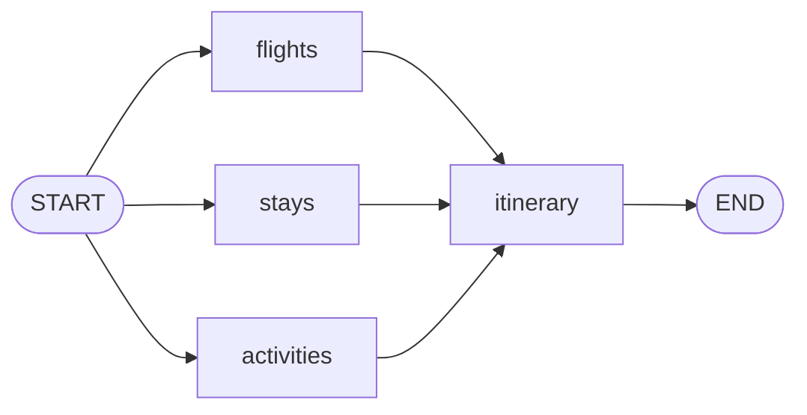

<p align="center">
  
</p>

<h1 align="center">GraphTrotter</h1>
**Live flights and hotels, an AI-written itinerary, and an honest budget check, built as a parallel LangGraph workflow.**

Give it an origin, a destination, dates, travellers, cabin class and a budget. Three branches run at the same time (flights, hotels, activities), then an itinerary node writes the plan from the results. If the cheapest realistic plan doesn't fit your budget, it tells you by how much.


## Why this project is different

Most "AI travel planner" demos ask a model for prices and present the answer as fact. When I checked those numbers against real sites, they were wrong:

| What I checked | Model's answer | Reality |
|---|---|---|
| Indore to London, economy, flight | 80,000 to 95,000 INR | 116,706 INR (live Google Flights fare) |
| A central Paris hotel, per night | about 14,000 INR | about 26,000 INR on a booking site |

So GraphTrotter uses real data wherever a model would only be guessing, and labels every section by how reliable it is.

| Section | Source | Reliability |
|---|---|---|
| Flights | Google Flights, fetched live through an Apify actor | Live fare, with times, stops and a link to the search. Falls back to clearly labelled AI estimates if the fetch fails |
| Hotels | Booking.com, fetched live through an Apify actor | Live price, **before taxes and fees**. Unrated and sold-out hotels are filtered out |
| Activities | LLM | AI estimates, not live prices |
| Itinerary | LLM | Written only from facts that code assembles (dates, flight times, chosen hotel, activities) |
| Budget summary | Plain Python | Calculated in code, never by the model |

## Architecture



- **Parallel fan-out, fan-in.** The three data nodes run concurrently, so total latency is roughly the slowest branch, not the sum. The itinerary node waits for all three.
- **Failures stay local.** Each node catches its own errors and writes them to a shared `errors` list (a reducer lets parallel nodes append safely). One broken source never blocks the others, and the UI says exactly what is missing.
- **Structured output you can trust.** The LLM nodes return validated Pydantic objects using JSON-schema mode with retries.
- **The model writes prose, code does the maths.** Totals, rooms, nights, per-person prices and over-budget amounts are all computed in Python.

## Tech stack

Python, LangGraph, LangChain (`langchain-groq`), Groq (`openai/gpt-oss-120b`), Apify actors for live data, Pydantic v2, Streamlit, pytest, LangSmith for tracing.

## Features

- Live round-trip fares with outbound and return times, stops and layover cities
- Live hotel prices with guest ratings, free-cancellation flag and a booking link
- City name to airport code resolution (type "Indore", get `IDR`)
- Passengers, cabin class and automatic room count
- Budget check with a clear over-budget warning
- Day-by-day itinerary that respects overnight flights
- CLI (`main.py`) and Streamlit web app (`app.py`)

## Getting started

```bash
git clone <this-repo>
cd graphtrotter
python -m venv .venv
source .venv/bin/activate        # Windows: .venv\Scripts\activate
pip install -r requirements.txt
pip install -e .
cp .env.example .env             # then fill in your keys
```

`.env`:

```
LLM_PROVIDER=groq
LLM_MODEL=openai/gpt-oss-120b
GROQ_API_KEY=...
APIFY_TOKEN=...

# optional tracing
LANGSMITH_TRACING=true
LANGSMITH_API_KEY=...
LANGSMITH_PROJECT=graphtrotter
```

Run it:

```bash
streamlit run app.py          # web app
python main.py                # command line
```

**Cost note:** every trip plan triggers two Apify runs (flights and hotels) plus a few model calls. Check the pricing of the actors and your Groq limits before running it repeatedly.

## Project structure

```
src/travel_planner/
  config.py        model selection from environment variables
  schemas.py       Pydantic models (request, flights, stays, activities)
  state.py         LangGraph state, including the errors reducer
  prompts.py       prompt templates
  budget.py        totals, nights, rooms, budget shares and notes
  airports.py      city name to airport code
  graph.py         the StateGraph wiring
  nodes/
    flights.py     live Google Flights fares, with AI-estimate fallback
    stays.py       live Booking.com hotels, filtered and ranked in code
    activities.py  AI-estimated activities
    summarize.py   builds a facts block in code, then writes the itinerary
app.py             Streamlit UI
main.py            CLI
tests/             unit and graph tests (no network calls)
eval/
  run_eval.py      live evaluation script (costs money, run by hand)
  show_itineraries.py  prints the itineraries saved by the last eval run
docs/              demo GIF and LangSmith trace screenshot
langgraph.json     for LangGraph Studio (`langgraph dev`)
```

## Testing

```bash
pytest -q
```

44 unit and graph tests run with fake models and mocked scrapers, so they are free and fast. They cover input validation, budget arithmetic, hotel filtering, airport resolution, live-fare conversion, graceful degradation when a source fails, and fallback from live fares to estimates.

## Evaluation

`eval/run_eval.py` runs real trips through the real graph. It costs money, so I run it by hand.

```bash
python eval/run_eval.py --list
python eval/run_eval.py --only economy_2pax_fits
```

Cases: an affordable 2-person trip, a solo trip, 3 travellers (two rooms), business class over budget, a different route, and an unknown-city guard. Checks include currency, live-fare status, hotel ratings, hotel price arithmetic, total equals the sum of parts, the over-budget flag, and that the itinerary covers every day.


First full run: all cases passed the hard checks, with 5 warnings. Four were a flaw in my own check (it looked for the text "Day 1" while the model wrote dates), which I fixed. One was a fare slightly above Google's "typical" range, which I left as a warning because it can legitimately happen in peak season.

Observed run time was about 16 to 48 seconds per trip, dominated by the live data calls.

## Observability

Runs are traced in LangSmith, which makes the parallel branches, per-node latency and model inputs and outputs visible.

docs/trace.png

## What went wrong along the way

These are the problems I hit and what I changed.
Major problems faced:-
1. **Model-estimated prices were off.** Flight and hotel prices from the model didn't match real sites, so both now come from live sources, with the model kept only as a labelled fallback for flights.
2. **A scraped hotel price was about 6% below the site.** The cause was taxes: the scraper returns the price before taxes and fees. I chose not to hard-code a correction (tax rules change) and label the price as pre-tax in the UI.
3. **Intermittent tool-call failures.** In function-calling mode the model sometimes filled the schema like a search tool and the API rejected it. Switching to JSON-schema structured output with retries fixed it.
4. **Tests caught real bugs.** A passenger limit that was only half enforced, and a fallback path that returned a dict where the UI expected a list.
5. **The itinerary ignored overnight flights.** Reading real outputs showed it "arrived" a day early. The fix was to give the itinerary node the actual flight times and rules about what it may not invent.

### Smaller fixes

1. **Currency.** Field names and prompts mixed USD and INR, so the model gave inconsistent prices. I added a currency selector (INR, USD, EUR, GBP), made the field names currency-neutral, and passed the chosen currency into the prompts and both live data sources.
2. **Invented flight times.** The model produced departure and arrival times for flights that don't exist. I removed those fields, then replaced the estimates with live Google Flights data (real times, stops and layovers).
3. **Passenger count inflated prices.** With more than one traveller, the model returned party totals for a field defined as "per person", and my code multiplied them again. I now ask for per-person prices only and multiply in Python (`budget.py`).
4. **Unavailable models.** The model I first planned to use doesn't exist under that name, and a second one was Enterprise-only on my API plan. I picked a model from the provider's public list.
5. **Messy scraper results.** The hotel scraper returns unrated and sold-out listings, and the flights scraper returns duplicate itineraries. Both are filtered or deduplicated in code.

## Known limitations

- Flights use Google Flights data and hotels use Booking.com data, both through third-party Apify actors. They can break if those sites change, and they may be subject to the sites' terms of service. This is a personal and educational project, not affiliated with Google or Booking.com.
- Hotel prices exclude taxes and fees. The budget summary also excludes food, local transport, visa and insurance, and the UI says so.
- Activity prices and descriptions are AI estimates.
- Hotels are searched from the first travel date. With an overnight flight, the first night may be paid but unused.
- One main airport per city. Cities with several airports (for example London) use one by default; you can type an airport code instead.
- A fare shown as "business" may include economy legs on some itineraries. I have not verified how the actor reports cabin per leg.
- Fares and rooms change constantly. Always follow the booking links before relying on a price.

## Roadmap

- Search hotels from the actual arrival date
- Cache live results for a few minutes to save cost
- Let the user pick a hotel, then re-plan activities nearby (LangGraph interrupts and a checkpointer)
- Per-leg cabin information for flights

## License

<!-- TODO: add a license (for example MIT) and your name -->
